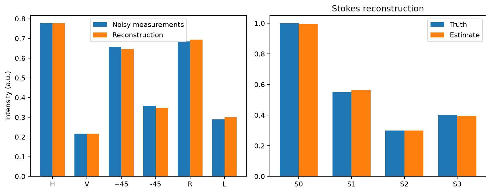

# Stokes polarimetry — OptiIA Consulting

Reconstruct polarization from six ideal analyzer measurements.

An executable project example using generated data. Images and graphs below are generated by the included code.



## Run

Python 3.12 recommended:
```bash
python -m pip install -r requirements.txt
python -m unittest -v test_analysis
python analysis.py --seed 42 --out results
```

The script writes plots, a data export and JSON metrics to `results/`. The committed `metrics.json` and `preview.png` correspond to seed 42. Import the functions in `analysis.py` to process your own compatible arrays.

## Method

Six analyzer channels H, V, +45, -45, R and L encode S0, S1, S2 and S3. Solve the overdetermined linear system, compute degree of polarization and report channel residuals. Circular convention is explicitly S3 = I_R - I_L. Independent channel noise can yield nonphysical estimates; these are flagged, not silently projected.

## Assumptions and limitations

Ideal analyzers and equal gains. No waveplate calibration, Mueller matrix inference or instrument control. Circular handedness depends on the stated convention. Real data require dark subtraction and analyzer calibration.

Synthetic results establish reproducibility of this example, not performance on real instruments. No proprietary source code, data or photographs are included.

## Validation

Four tests exercise exact reference cases, independent data or noise realizations, and input validation. See `test_analysis.py` for thresholds and checks.

## Related activities

Scientific computing, instrumentation data analysis, image processing and Python automation.

[More project examples](https://github.com/yaghi-ali) · [OptiIA Consulting](https://www.optiia-consulting.fr) · contact@optiia-consulting.fr
